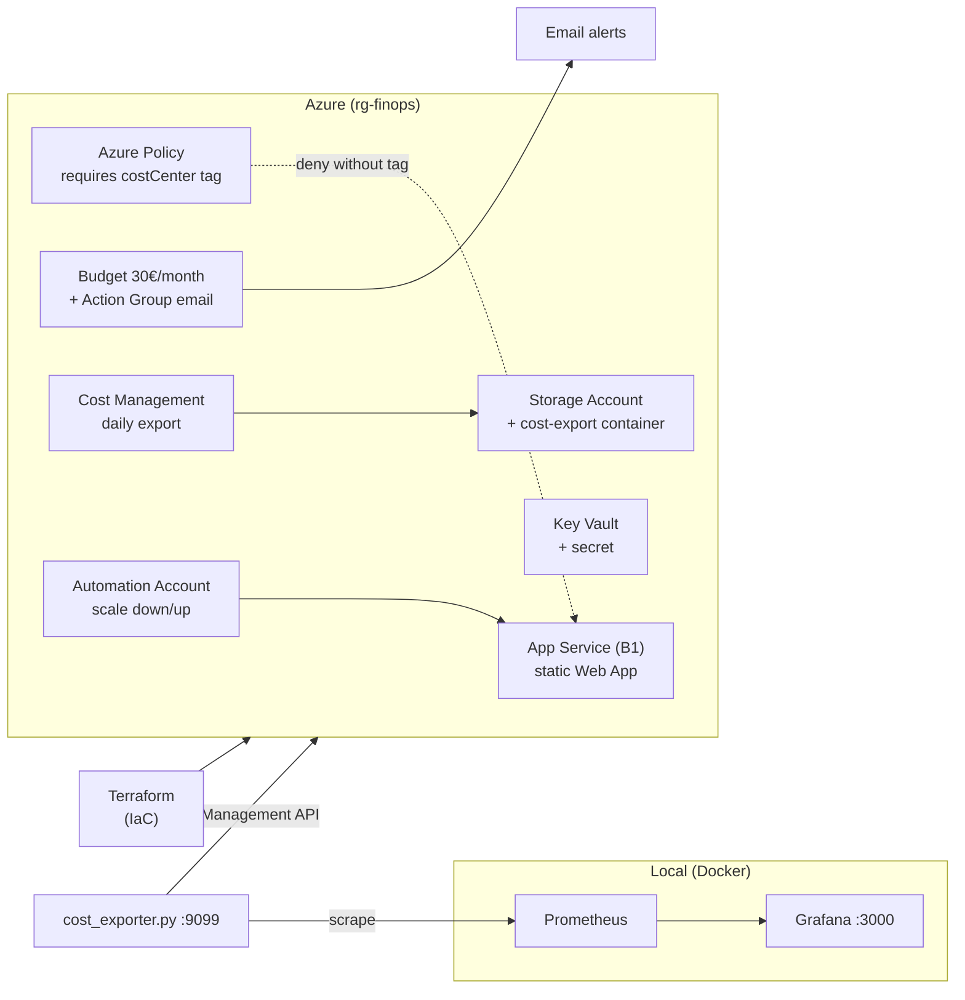

# Azure cost governance (FinOps + AZ-900)

[](#)
[](LICENSE)
[](scripts/)
[](terraform/)

A small personal project to practice public-cloud cost management on Azure. It
deploys a minimal workload with Terraform and wraps it in a full **FinOps** loop,
touching the core services from the **AZ-900** syllabus.

## What it does

| Piece | What it demonstrates |
|---|---|
| `Azure Policy` (custom, `deny`) | No resource can be created without a `costCenter` tag → **cost allocation** |
| Monthly budget + Action Group | Email alerts at 80% / 100% / 110% → **budgeting & forecasting** |
| Daily cost export to Storage | Historical data for analysis → **cost reporting** |
| Automation Runbook + schedule | Scales the App Service Plan to `Free` at night and back to `B1` by day → **workload optimization** |
| `cost_exporter.py` + Prometheus + Grafana | Visual dashboard of actual cost by RG and service → **cost visibility** |
| `finops_scan.py` | Detects orphaned disks, idle public IPs, deallocated VMs → **rightsizing** |
| GitHub Actions CI | `terraform fmt` + `validate` + `tflint` + Trivy security scan on every push; Infracost cost estimate on PRs → **shift-left quality, security & cost** |
| Remote state backend | Terraform state in an encrypted Storage Account (with locking) → **production-grade IaC** |

## Results

The FinOps loop closes with measurable outcomes:

- **Off-hours compute → €0** — the runbook scales the App Service Plan from
  `B1` to `Free` (F1) every night and back up in the morning.
- **Budget guardrails** — a 30 €/month budget with email alerts at 80 / 100 / 110 %.
- **Zero untagged resources** — the deny policy blocks anything without a
  `costCenter` tag, so every euro stays attributable.
- **Continuous visibility** — daily Cost Management exports + a Grafana
  dashboard and a rightsizing scanner for orphaned/idle resources.

## Architecture



## Repository layout

```
.
├── .github/workflows/  # CI: terraform fmt/validate/tflint + Trivy + Infracost
├── terraform/          # IaC (providers, app, storage, kv, policy, budget, export, automation, state backend)
├── app/                # Minimal static web app
├── scripts/            # cost_exporter.py, finops_scan.py and bootstrap_backend.sh
├── grafana/            # docker-compose (Prometheus + Grafana) + dashboard
├── docs/               # Architecture, setup and FinOps/AZ-900 mapping
└── README.md
```

## Quick start

```bash
az login
cd terraform
cp terraform.tfvars.example terraform.tfvars   # edit your email and budget

# Remote state backend (once) — full steps in docs/setup.md
bash ../scripts/bootstrap_backend.sh
cp backend.hcl.example backend.hcl             # fill in the printed values
terraform init -backend-config=backend.hcl

terraform plan && terraform apply
```

See the docs for the full walkthrough:

- [docs/architecture.md](docs/architecture.md) — components and how they fit together
- [docs/setup.md](docs/setup.md) — prerequisites and step-by-step instructions (including Grafana and the scripts)
- [docs/finops-practices.md](docs/finops-practices.md) — FinOps framework mapping and AZ-900 alignment

## Destroying (important, don't burn credit!)

```bash
cd terraform
terraform destroy
```

Don't leave the infrastructure running: even though the nightly scale-down and the
budget protect it, FinOps rule number one is **shut down what you don't use**.
