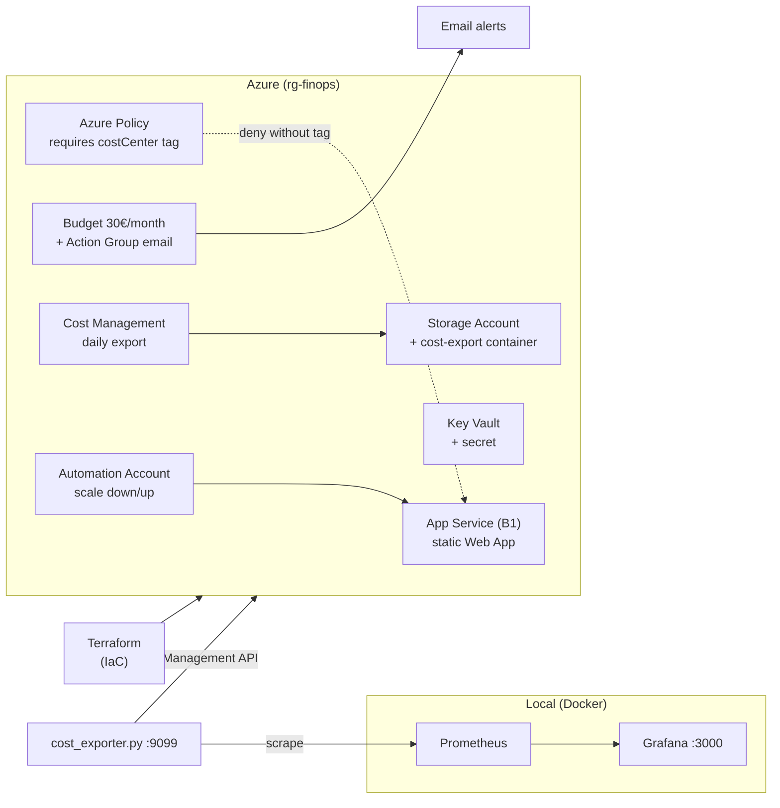

# Architecture

## Overview

The project provisions a single Azure resource group (`rg-finops`) containing a
minimal workload and a set of cost-governance controls around it. Everything is
defined as code with Terraform.

## Components

### Workload (the thing being governed)

| Resource | Purpose |
|---|---|
| App Service Plan `B1` | Hosts the web app. It is the resource that gets scaled down at night. |
| Web App (Linux) | Minimal static site. Intentionally trivial — the project is about governance, not the app. |
| Storage Account (LRS) | Hosts the `cost-export` container that receives the daily cost export. |
| Key Vault | Holds a sample secret. The access policy is granted to the identity running Terraform. |

### Governance & cost controls

| Resource | FinOps purpose |
|---|---|
| Azure Policy (custom, `deny`) | Blocks any resource without a `costCenter` tag. |
| Budget + Action Group | Monthly budget with email alerts at 80% / 100% / 110%. |
| Cost Management export | Daily `ActualCost` (MonthToDate) export to Storage for historical analysis. |
| Automation Account + runbook | Scales the App Service Plan to `Free` at night and back to `B1` in the morning. |

### Local observability stack

| Component | Purpose |
|---|---|
| `cost_exporter.py` | Queries the Cost Management API and exposes Prometheus metrics on `:9099`. |
| Prometheus | Scrapes the exporter every 5 minutes (default `scrape_interval: 5m`). |
| Grafana | Shows the "FinOps - Azure Costs" dashboard. |

## Naming

- Globally-unique names (Storage Account, Key Vault) get a random 6-char suffix.
- All resources are tagged with `costCenter`, `environment`, `owner`, `project` and `createdBy`.

## Alignment with Azure Well-Architected Framework

The project maps onto the five **Azure Well-Architected Framework** pillars:

| Pillar | Implementation in this project |
|---|---|
| Cost Optimization | Budget + alerts, nightly scale-down, daily cost export, rightsizing scanner |
| Security | Key Vault with least-privilege access, https-only, TLS 1.2, RBAC-scoped runbook identity |
| Reliability | Managed App Service platform; automation keeps the plan inside budget |
| Operational Excellence | IaC (Terraform), CI (fmt/validate/tflint + Trivy + Infracost), remote state backend |
| Performance Efficiency | Scale up/down by demand window |

The tagging + policy approach follows the **Cloud Adoption Framework (CAF) governance**
pattern. In a larger organization this stack would live in a **Landing Zone** with a
dedicated management/connectivity subscription.

## IaC note

The project uses **Terraform** (azurerm) as the multi-cloud IaC standard. For an
Azure-only estate, **Bicep** (the Azure-native DSL) or ARM templates are the
equivalent alternatives — the governance resources (Policy, Budget, Cost Export)
map 1:1.
